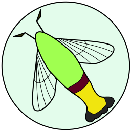

# Cephylas Logger and Visualizer
Cephylas is a simple resource usage logger & visualizer for docker containers.

CephylasはDocker containerのリソース使用率を記録・可視化する
Rust + Next.js によるWebアプリケーションです。

## Screenshots

## Name and Logo
inspired by super cute kawaii insect _cephonodes hylas_, which has pretty transparent wings!

名前は _cephonodes hylas_ という学名の虫から取っています。透明な羽のかわいいやつです。

## Documents
- [prd/](./prd/README.md) — 仕様の正典（目的 / 構成 / core / web / 公開範囲 / デプロイ）
- [AGENTS.md](./AGENTS.md) — 開発ガイド
- [紹介記事 (Zenn)](https://zenn.dev/daiius/articles/8f38ae1893c166) — 作った動機と初期の設計

## Design
- **Backend** (`core/`): Rust. Logs Docker API stats to a file, caches usage in memory,
  and serves JSON over a hand-written HTTP server. The only dependency is
  [json](https://docs.rs/json/latest/json/).
- **Frontend** (`next/`): Next.js + Chart.js. Renders usage charts from the core API
  in Server Components.

Details: [prd/01-architecture.md](./prd/01-architecture.md)
