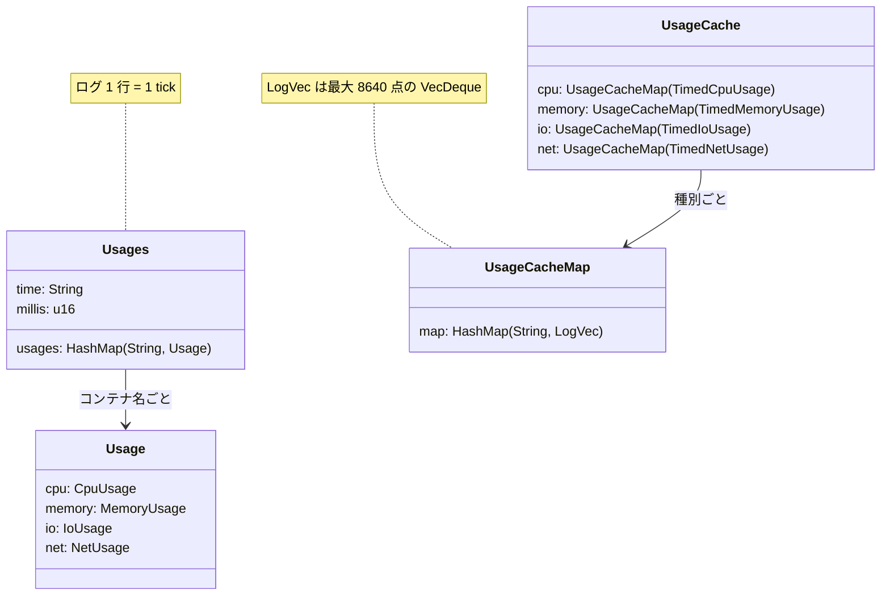
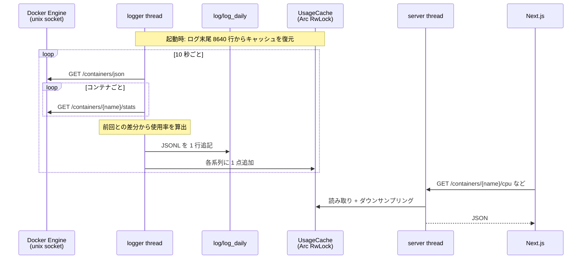

# Cephylas core

Docker container のリソース使用率を記録し、REST API で返す Rust 製の単一バイナリ。

Cephylas comes from "cephonodes hylas", a kind of moth with clear wings.

**仕様は [prd/02-core.md](../prd/02-core.md) にある**（収集 / 使用率の算出 / ログ形式 /
キャッシュ / ダウンサンプリング / REST API / 既知の問題）。

## 実行

```bash
cargo run            # ./log/log_daily を読み書きし、/var/run/docker.sock を読む
```

`0.0.0.0:7878` で待ち受ける。開発時の起動方法は [AGENTS.md](../AGENTS.md) を参照。

## データ構造



## 処理の流れ


